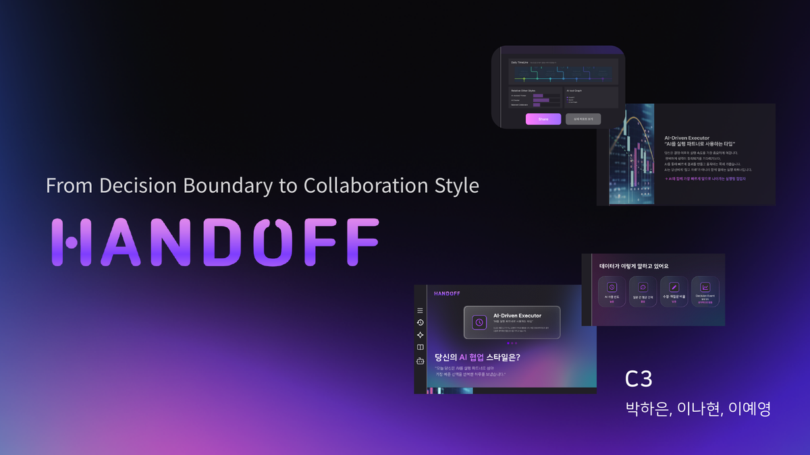
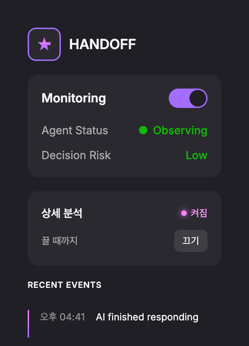
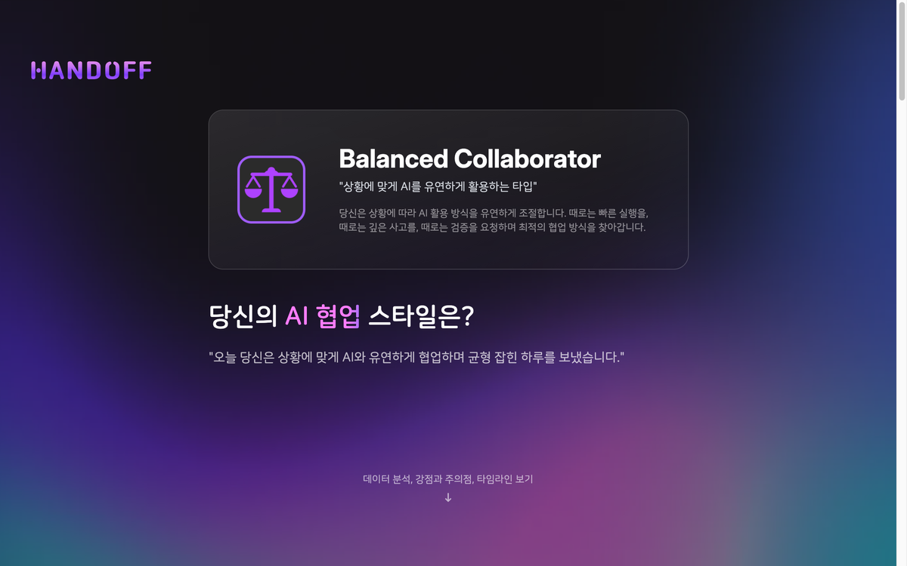
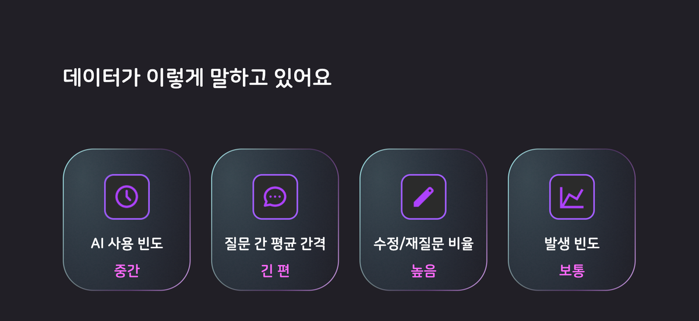
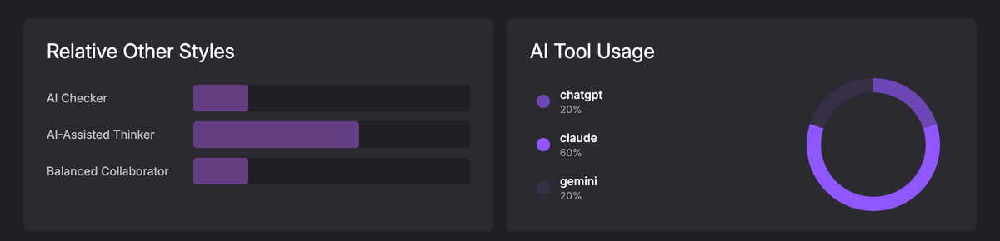
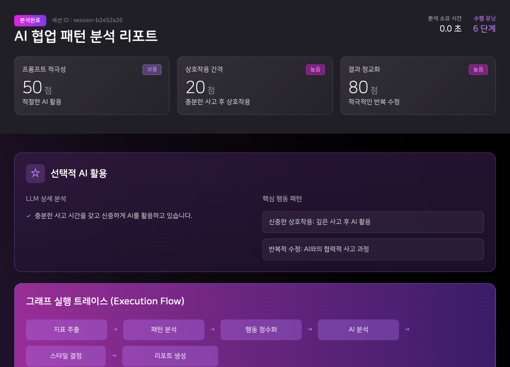
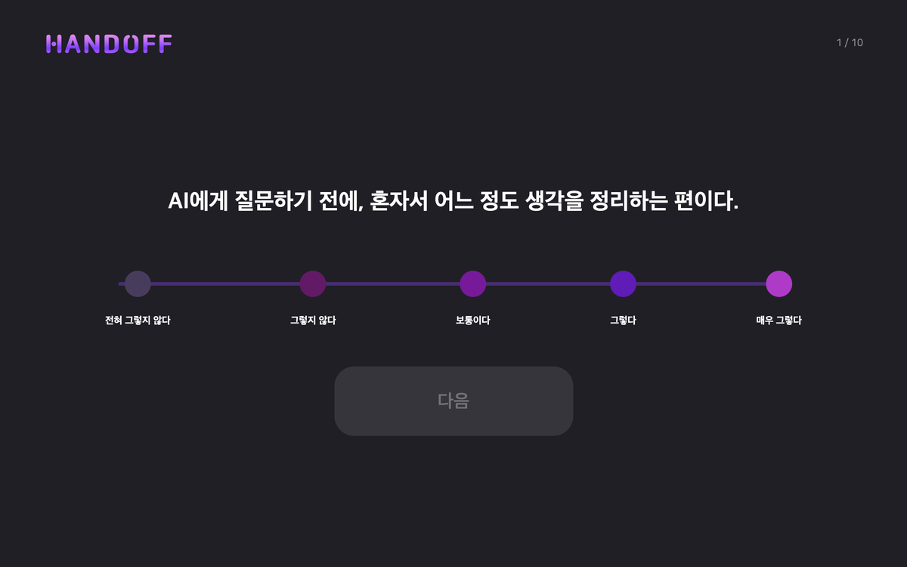
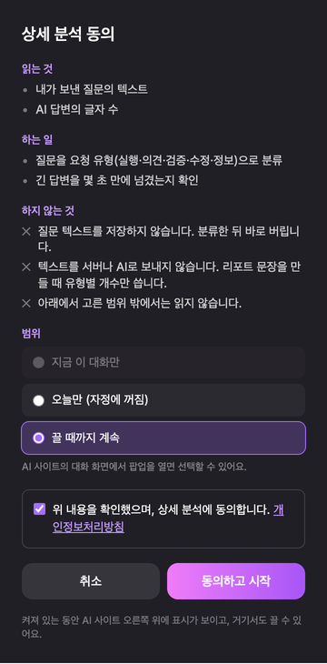
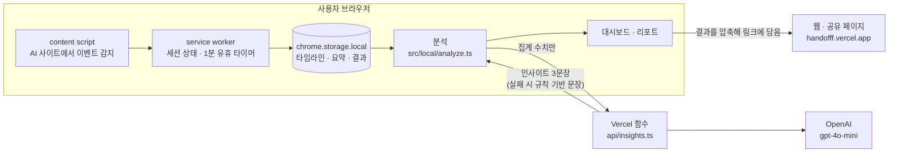

<p align="center">
  
</p>

<h1 align="center">HANDOFF</h1>

<p align="center">
  <strong>당신은 AI와 어떻게 협업하고 있나요?</strong><br>
  프롬프트를 읽지 않고, AI를 쓰는 <b>행동</b>만으로 판단이 AI에게 넘어가는 순간을 찾아<br>
  나의 AI 협업 스타일로 보여 주는 Chrome 확장 프로그램<br>
  <sub>원하면 동의 후 질문 유형까지 분석하는 <b>상세 분석</b>도 켤 수 있습니다</sub>
</p>

<p align="center">
  <a href="https://handofff.vercel.app">소개 페이지</a> ·
  <a href="https://handofff.vercel.app/#/survey-intro">설치 없이 설문 해보기</a> ·
  <a href="https://www.youtube.com/watch?v=AWG6oKiDhTY">데모 영상</a> ·
  <a href="https://handofff.vercel.app/privacy.html">개인정보처리방침</a>
</p>

<p align="center">
  
  
  
  
  
  
</p>

---

## 왜 만들었나

> “AI를 많이 쓰지만, 나는 AI를 ‘어떻게’ 쓰고 있는지 모른다.”

AI가 써 준 답을 보고 결정을 내렸을 때, 그 결정이 내가 따져서 고른 것인지 AI 답을 그대로 받아들인 것인지 구분하기 어렵습니다. 기존의 AI 사용 분석은 사용 시간, 질문 횟수, 결과물처럼 **결과**만 보기 때문에 판단이 AI에게 넘어간 순간은 어디에도 기록되지 않습니다.

HANDOFF는 AI 사용을 점이 아니라 **흐름**으로 봅니다. 질문이 더 이상 이어지지 않고 AI의 답이 그대로 행동으로 이어지는 순간을 **Decision Boundary**라고 정의하고, 이 순간을 프롬프트 내용 없이 행동만으로 포착합니다.

| 기존 방식이 보는 것 | 놓치는 것 | HANDOFF가 보는 것 |
|---|---|---|
| 사용 시간, 질문 횟수 | 질문 사이의 판단 흐름 | 질문 간격의 변화, 연속·재질문 패턴 |
| 출력 품질, 생산성 | 결과에 이르기까지의 선택 과정 | 수정·되묻기·채택 시점 |
| “AI를 많이 쓴다”는 자기 인식 | 실제 행동과의 차이 | 실제 행동 기록 기반 유형화 |

**HANDOFF는 AI 평가 도구가 아닙니다.** AI 결과의 품질을 매기거나, 사용량에 점수를 주거나, 옳고 그름을 판단하지 않습니다. 관찰하고 보여 줄 뿐입니다.

## 화면

<table>
  <tr>
    <td width="32%" valign="top"><br><sub><b>팝업</b> · 기록 켜기/끄기와 최근 이벤트</sub></td>
    <td valign="top"><br><sub><b>협업 스타일 결과</b> · 오늘의 스타일과 한 줄 메시지</sub></td>
  </tr>
  <tr>
    <td colspan="2"><br><sub><b>데이터 요약</b> · AI 사용 빈도, 질문 간 평균 간격, 수정·재질문 비율, 결정 구간 빈도</sub></td>
  </tr>
  <tr>
    <td colspan="2"><br><sub><b>스타일 비교 · 도구별 사용 비율</b></sub></td>
  </tr>
  <tr>
    <td colspan="2"><br><sub><b>분석 리포트</b> · 패턴 점수, AI 인사이트, 단계별 분석 흐름</sub></td>
  </tr>
  <tr>
    <td colspan="2"><br><sub><b>설문</b> · 확장 프로그램 없이 10문항으로 진단</sub></td>
  </tr>
</table>

## 주요 기능

- **자동 기록**: ChatGPT, Claude, Gemini에서 프롬프트 전송과 AI 응답 시작·종료 시각을 기록합니다. 따로 누를 것은 없습니다.
- **협업 스타일 분석**: 기록한 행동으로 4가지 스타일 중 하나를 고르고, 다른 스타일과의 상대 점수도 보여 줍니다.
- **대시보드**: 스타일 카드, 강점과 주의할 점, 하루 타임라인, 도구별 사용 비율.
- **분석 리포트**: 패턴별 점수, 단계별 분석 흐름, LLM이 정리한 인사이트 3문장.
- **상세 분석 (선택)**: 동의한 범위(이 대화만, 오늘만, 끌 때까지)에서 질문을 실행·의견·검증·수정·정보 요청으로 분류합니다. 텍스트는 분류 직후 버립니다.
- **공유 링크**: 결과를 링크로 공유합니다. 결과가 링크 주소 안에 압축돼 들어가며 24시간 뒤 만료됩니다.
- **설문**: 확장 프로그램 없이 10문항으로 스타일을 진단합니다.
- **한국어 / 영어**

## 4가지 협업 스타일

| 스타일 | 한 줄 설명 | 행동 신호 |
|---|---|---|
| **AI-Driven Executor** | AI를 실행 파트너로 사용하는 타입 | 답을 받자마자 다음 질문, 길게 이어 물음 |
| **AI-Assisted Thinker** | AI와 함께 깊이 생각하는 타입 | 답을 오래 읽고 생각한 뒤, 길게 대화 |
| **AI Checker** | AI를 검증 파트너로 활용하는 타입 | 가끔 열어서 한두 번만 묻고 끝냄 |
| **Balanced Collaborator** | 상황에 따라 유연하게 협업하는 타입 | 생각 시간도, 대화 길이도 중간 |

## 상세 분석 (선택)



시간만으로는 30초가 답을 읽은 시간인지 딴짓한 시간인지 알 수 없습니다. 더 정확히 알고 싶은 사람은 동의하고 상세 분석을 켤 수 있습니다.

1. 팝업에서 **상세 분석 켜기** → 동의 화면에서 읽는 것, 하는 일, 하지 않는 것을 확인합니다.
2. 범위를 고릅니다: 지금 이 대화만, 오늘만(자정에 꺼짐), 끌 때까지(기본값). "이 대화만"은 다른 대화로 가면 멈춥니다.
3. 동의 체크를 해야 시작 버튼이 눌립니다.
4. 켜져 있는 동안 AI 사이트 오른쪽 위에 표시가 뜨고, 거기서 바로 끌 수 있습니다.

질문은 `content script` 안에서 그 자리에서 분류되고 텍스트는 버립니다. 저장되는 것은 유형, 질문 글자 수, 답변 글자 수뿐입니다.

| 더 보이는 것 | 판단에 주는 의미 |
|---|---|
| 요청 유형 (실행·의견·검증·수정·정보) | 시간으로 추측하던 것을 직접 확인. 스타일 점수에 최대 50%까지 반영 |
| 긴 답변(1,500자 이상)을 5초 안에 넘긴 횟수 | 안 읽고 넘어간 답변 |
| 평균 질문 길이 | 맥락을 직접 주는지, 짧게 맡기는지 |

분류는 표현 목록 기반이라 애매한 문장은 틀릴 수 있고, 여러 유형에 걸리면 수정 → 검증 → 의견 → 정보 → 실행 순으로 정합니다 (`src/local/intent.ts`).

<br clear="right">

## 개인정보

- 기본 분석은 프롬프트와 AI 응답의 **텍스트를 읽지 않습니다.** 이벤트 종류와 시각만 씁니다. 상세 분석을 켜도 텍스트는 저장하거나 보내지 않습니다.
- 기록과 분석 결과는 **브라우저 안(`chrome.storage.local`)에만** 저장됩니다. 사용자 기록을 보관하는 서버가 없습니다.
- 로그인이 없고 사용자 식별자도 만들지 않습니다.
- 브라우저 밖으로 나가는 것은 리포트 문장을 만들 때 보내는 **집계 수치**(프롬프트 수, 평균 간격, 등급, 점수, 상세 분석 시 요청 유형별 개수)뿐이며, 이 값도 저장하지 않습니다.
- 웹 소개 페이지는 Vercel Web Analytics로 방문 수를 쿠키 없이 집계합니다. 공유 링크 안의 결과는 보내지 않고, 확장 프로그램에는 들어가지 않습니다.
- 확장 프로그램 권한은 `storage`, `alarms`와 지원하는 AI 사이트 4곳뿐입니다.

자세한 내용은 [개인정보처리방침](https://handofff.vercel.app/privacy.html)에 있습니다.

## 구조



### 분석 단계

분석은 6단계로 나뉘며, **스타일과 점수는 모두 규칙으로 정하고 LLM은 설명 문장에만 씁니다.** 그래서 LLM이 실패해도 같은 결과가 나오고, 결과가 실행할 때마다 흔들리지 않습니다.

1. **지표 추출**: 프롬프트 수, **생각 시간**(AI 답변이 끝난 뒤 다음 질문까지), 한 대화에서 이어 묻는 횟수, 수정·재질문 횟수(답변 후 20초 안에 다시 물음), 결정 구간 수. 10분 넘게 쉬면 대화가 끊긴 것으로 보고 그 공백은 빼고 계산합니다.
2. **패턴 분석**: 두 축으로 정리합니다. **속도**(답을 받고 얼마나 빨리 다음으로 넘어가는가)와 **깊이**(한 번 시작하면 얼마나 길게 이어 묻는가).
3. **행동 점수화**: 두 축 위에 놓인 4가지 스타일 기준점까지의 거리로 점수를 계산해 정규화합니다. 가운데는 Balanced, 네 방향 끝은 각 스타일입니다. 상세 분석 기록이 있으면 요청 유형이 가리키는 스타일 점수를 최대 50%까지 섞습니다.
4. **AI 분석**: 집계 수치를 LLM에 보내 인사이트 문장 생성 (실패 시 규칙 기반 문장)
5. **스타일 결정**: 점수가 가장 높은 스타일
6. **리포트 생성**: 대시보드와 리포트용 데이터 구성

<details>
<summary>왜 해커톤 버전에서 계산 방식을 바꿨나</summary>

해커톤 버전은 질문과 질문 사이 시간을 그대로 간격으로 썼습니다. 여기에는 AI가 답을 쓰는 시간과 쉬는 시간이 섞여 있어 거의 모든 사용자가 "간격 김"으로 분류됐고, 질문 수도 세션 전체 합계라 브라우저를 오래 켜 둘수록 결과가 바뀌었습니다. 습관을 알고 있는 가상 사용자로 비교하면 다음과 같습니다.

| 가상 사용자의 실제 습관 | 해커톤 버전 결과 | 지금 결과 |
|---|---|---|
| 답을 받자마자 바로바로, 길게 이어 물음 | Thinker 99% | **Executor 100%** |
| 오래 읽고 생각하며 길게 대화 | Thinker 65%, Executor 32% | **Thinker 100%** |
| 가끔 한두 번만 물음 | Checker 100% | **Checker 100%** |
| 적당히 읽고 몇 번 이어감 | Checker 65%, Thinker 36% | **Balanced 99%** |

습관을 고르게 섞은 가상 사용자 1,000명으로 보면, 해커톤 버전은 Balanced가 한 명도 나오지 않았고(Checker 52%, Thinker 38%) 지금은 네 유형이 19~29%로 나뉩니다. 기준값(생각 시간 8초·90초, 이어 묻기 6회)은 실제 사용 데이터를 보며 조정할 예정입니다.

</details>

## 시작하기

### 요구 사항

- Node.js 20 이상
- Chrome

### 설치와 빌드

```bash
git clone https://github.com/scoopAI-C3/C3_frontend.git
cd C3_frontend
npm install
npm run build        # dist/ 에 확장 프로그램과 웹이 함께 빌드됨
```

### Chrome에 직접 올려 보기

1. `chrome://extensions` 접속
2. 오른쪽 위 **개발자 모드** 켜기
3. **압축해제된 확장 프로그램을 로드합니다** → `dist` 폴더 선택
4. ChatGPT, Claude, Gemini 중 하나에서 대화한 뒤 툴바의 HANDOFF 아이콘을 누릅니다.

### 명령어

| 명령어 | 설명 |
|---|---|
| `npm run dev` | 개발 서버 (확장 프로그램은 `dist`를 로드하면 자동 반영) |
| `npm run build` | 타입 검사 후 배포 빌드 (디버그 로그 제거) |
| `npm run zip` | 빌드 후 스토어 제출용 `handoff-extension.zip` 생성 |
| `npm run lint` | ESLint |

### 환경 변수

모두 선택 사항입니다. `.env.example`을 참고하세요.

| 변수 | 위치 | 설명 |
|---|---|---|
| `VITE_INSIGHTS_URL` | 빌드 | LLM 함수 주소 (기본 `https://handofff.vercel.app/api/insights`) |
| `VITE_WEB_URL` | 빌드 | 공유 링크가 열리는 웹 주소 (기본 `https://handofff.vercel.app`) |
| `VITE_STORE_URL` | 빌드 | 웹 스토어 등록 후 설치 링크. 비우면 GitHub 링크와 수동 설치 안내 표시 |
| `OPENAI_API_KEY` | Vercel | LLM 함수용 키. 없으면 규칙 기반 문장으로 대체 |
| `OPENAI_MODEL` | Vercel | 기본 `gpt-4o-mini` |
| `ALLOWED_ORIGINS` | Vercel | LLM 함수를 호출할 수 있는 오리진 (쉼표 구분) |

## 배포

- **웹·LLM 함수**: GitHub `main`에 머지하면 Vercel이 자동으로 배포합니다. 루트(`/`)는 소개 페이지, `/#/share/...`는 공유 결과, `/privacy.html`은 개인정보처리방침입니다.
- **확장 프로그램**: `npm run zip`으로 만든 파일을 Chrome 웹 스토어에 올립니다. 등록 정보와 심사 답변은 [`store/STORE_LISTING.md`](store/STORE_LISTING.md)에 정리돼 있습니다.

## 프로젝트 구조

```
├── api/
│   └── insights.ts            # Vercel 함수: 집계 수치 → LLM 인사이트 3문장
├── docs/images/               # README 이미지
├── public/
│   ├── fonts/                 # Inter, NanumSquareRound (woff2)
│   ├── icons/                 # 확장 프로그램 아이콘 16/32/48/128
│   └── privacy.html           # 개인정보처리방침 (한/영)
├── src/
│   ├── background.ts          # service worker: 세션 상태, 유휴 타이머
│   ├── content.ts             # content script: AI 사이트 이벤트 감지
│   ├── apis/                  # 화면에서 쓰는 API (지금은 모두 브라우저 안에서 처리)
│   ├── local/                 # 분석 로직, 저장소, 공유 링크 인코딩, 문구 데이터
│   ├── pages/                 # 소개, 대시보드, 리포트, 설문, 공유 페이지
│   └── components/
├── store/                     # 웹 스토어 등록 자료와 스크린샷
└── manifest.json
```

## 해커톤 버전과 달라진 점

해커톤에서는 Spring Boot 백엔드와 SpoonOS(Python) 분석 서비스, MySQL로 운영했습니다 ([C3_backend](https://github.com/scoopAI-C3/C3_backend)). 정식 출시를 준비하면서 같은 분석 규칙을 확장 프로그램 안으로 옮기고, LLM 호출만 Vercel 함수 하나로 남겼습니다. 서버 운영비가 들지 않고, 사용자 기록이 브라우저 밖으로 나가지 않습니다.

## 팀

**C3** · 박하은, 이나현, 이예영

Scoop AI Hackathon in Seoul **우수상**

> We study how humans and AI collaborate — not just how AI performs.
